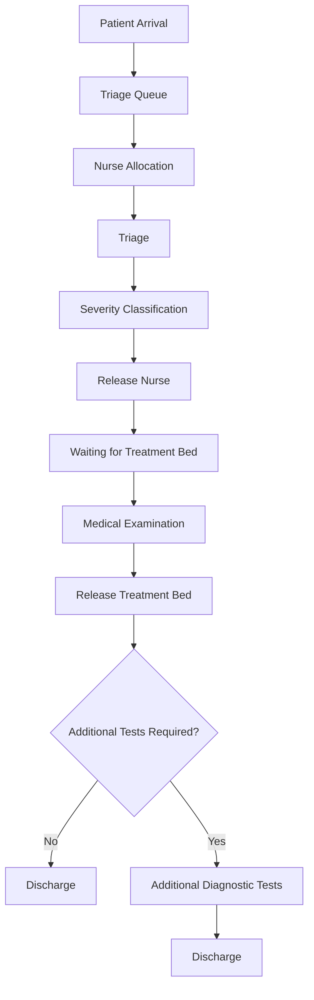

# Emergency Department Simulation – AnyLogic

A **Discrete Event Simulation (DES)** project developed in **AnyLogic** to analyze patient flow, resource utilization, and waiting times in a hospital Emergency Department.

The project was developed for the **Simulation** course at the **University of Milan – Department of Computer Science**, Academic Year **2026/2027**.

The simulation investigates how different numbers of doctors, nurses, and treatment beds affect the performance of an Emergency Department under stochastic patient arrivals and severity-based medical priorities.

## Project Overview

The objective of this project is to simulate the operation of an Emergency Department and evaluate different resource configurations to identify potential improvements in patient waiting times.

The model includes:

- Patient arrivals following a Non-Homogeneous Poisson Process.
- Triage procedures performed by nurses.
- Four patient severity codes.
- Priority-based allocation of medical resources.
- Preemptive medical examinations.
- Limited numbers of doctors, nurses, and treatment beds.
- Probabilistic additional diagnostic testing.
- Collection and statistical analysis of performance indicators.

A full-factorial experiment compares **27 resource configurations**, with **100 independent simulation replications per configuration**, for a total of **2,700 simulation runs**.

## Technologies

- **AnyLogic 8.9.10**
- **Process Modeling Library**
- **Discrete Event Simulation (DES)**
- **Java** for simulation logic and data collection
- **CSV** for exporting experimental results
- **LaTeX** for the scientific report

## Simulation Model

### Patient Flow

The Emergency Department is modeled as a sequence of discrete events, from patient arrival to discharge.



The model is implemented using blocks from the AnyLogic Process Modeling Library.

### 1. Patient Arrivals

Patients are generated through the `source` block according to a predefined arrival schedule.

The model uses a **Non-Homogeneous Poisson Process (NHPP)**, allowing the arrival intensity to vary throughout the day.

| Time Interval | Arrival Rate |
|---|---:|
| 00:00–08:00 | 10 patients/hour |
| 08:00–14:00 | 30 patients/hour |
| 14:00–24:00 | 15 patients/hour |

The expected number of arrivals over a complete day is approximately **410 patients**.

Actual arrivals vary between simulation runs because they are generated stochastically.

### 2. Triage

After entering the system, patients request an available nurse.

The triage process consists of:

1. Acquiring a nurse through a `Seize` block.
2. Performing triage through a `Delay` block.
3. Assigning a severity code.
4. Releasing the nurse.

Triage duration follows an Exponential distribution with a mean of **5 minutes**.

```java
exponential(1/5.0)
```

### 3. Severity Classification

At the end of triage, every patient receives a severity code between 1 and 4.

```java
agent.severityCode = uniform_discr(1, 4);
```

Each severity code has an equal probability of 25%.

| Severity Code | Priority Level |
|---|---|
| 1 | Highest |
| 2 | High |
| 3 | Medium |
| 4 | Lowest |

This uniform distribution is a modeling simplification and does not represent the actual severity distribution of a specific hospital.

### 4. Treatment Bed Allocation

After triage, patients request an available treatment bed through the `seizeLetto` block.

The allocation mechanism considers patient severity, giving higher priority to more urgent patients.

Patients occupy a treatment bed during their medical examination and release it after treatment.

### 5. Medical Examination and Preemption

Medical examinations are implemented through the `visitaMedica` Service block.

Doctors are represented as limited resources.

The model uses severity-based task priorities:

```java
5 - agent.severityCode
```

This expression assigns higher numerical priorities to more urgent patients.

The medical service supports **preemption**: when a higher-priority patient requires a doctor, an ongoing lower-priority examination may be suspended and subsequently resumed.

Preemption behavior was tested using AnyLogic event callbacks, confirming medical task suspension and resumption during simulation execution.

Medical examination duration follows a Normal distribution with:

- Mean: **20 minutes**
- Standard deviation: **5 minutes**
- Minimum duration: **1 minute**

```java
max(1, normal(5, 20))
```

### 6. Additional Diagnostic Tests

After the medical examination, patients follow one of two possible pathways:

- **60% probability:** direct discharge.
- **40% probability:** additional diagnostic tests before discharge.

The routing decision is implemented through the `selectOutput` block.

Patients requiring additional examinations pass through `ulterioriTest` and subsequently exit through `sink2`.

Patients discharged directly exit through `sink`.

## Key System Parameters (KSPs)

Three controllable parameters are evaluated:

| Parameter | Description | Values |
|---|---|---|
| `numeroMedici` | Number of doctors | 2, 3, 4 |
| `numeroInfermieri` | Number of nurses | 2, 3, 4 |
| `numeroLetti` | Number of treatment beds | 6, 8, 10 |

These parameters are varied systematically to evaluate the impact of resource availability on Emergency Department performance.

## Key Performance Indicators (KPIs)

The simulation collects the following performance indicators:

| KPI | Description |
|---|---|
| Mean Waiting Time | Average waiting time between patient arrival and the beginning of medical examination |
| Waiting Time by Severity Code | Average waiting time separately for severity codes 1–4 |
| Doctor Utilization | Fraction of time doctors are occupied |
| Nurse Utilization | Fraction of time nurses are occupied |
| Additional Test Rate | Proportion of completed patients requiring additional diagnostic tests |
| Completed Patients | Number of patients reaching the discharge blocks |

Waiting times are recorded when patients begin medical examination.

Consequently, patients still waiting at the end of the simulation horizon are not included in the recorded waiting-time averages.

## Experimental Design

The project includes a Parameter Variation experiment named:

`EsperimentoValidazione`

The experiment evaluates every combination of the three controllable parameters.

### Experimental Configuration

| Property | Value |
|---|---|
| Simulation horizon | 24 hours |
| Duration per replication | 1,440 simulated minutes |
| Number of doctors | 2–4 |
| Number of nurses | 2–4 |
| Number of beds | 6, 8, 10 |
| Total configurations | 27 |
| Replications per configuration | 100 |
| Total simulation runs | 2,700 |
| Confidence level | 95% |
| Target relative error | Below 5% |

The simulation evaluates:

**3 doctor configurations × 3 nurse configurations × 3 bed configurations = 27 scenarios**

Each scenario is executed 100 times to reduce statistical uncertainty.

### Statistical Methodology

The mean waiting time is estimated independently for every resource configuration.

A **95% confidence interval** is calculated using Student's t-distribution:

$$
CI_{95\%} = \bar{x} \pm t_{0.975,n-1}\frac{s}{\sqrt{n}}
$$

Where:

- $\bar{x}$ is the sample mean.
- $s$ is the sample standard deviation.
- $n$ is the number of independent replications.
- $t_{0.975,n-1}$ is the Student t critical value.

Relative error is defined as the confidence-interval half-width divided by the estimated mean.

The target precision is a relative error below **5%**, with a **95% confidence level**.

## Experimental Results

### Comparison of Resource Configurations

The following table summarizes the results obtained from the 2,700 simulation replications.

| Doctors | Nurses | Beds | Mean Waiting Time (min) | Relative Error |
|---:|---:|---:|---:|---:|
| 2 | 2 | 6 | 112.07 | 3.54% |
| 2 | 2 | 8 | 110.54 | 3.92% |
| 2 | 2 | 10 | 113.34 | 3.24% |
| 2 | 3 | 6 | 110.14 | 4.03% |
| 2 | 3 | 8 | 112.73 | 3.78% |
| 2 | 3 | 10 | 108.12 | 3.68% |
| 2 | 4 | 6 | 109.31 | 4.15% |
| 2 | 4 | 8 | 113.52 | 4.09% |
| 2 | 4 | 10 | 114.66 | 3.79% |
| 3 | 2 | 6 | 110.57 | 3.45% |
| 3 | 2 | 8 | 111.88 | 3.58% |
| 3 | 2 | 10 | 109.35 | 2.95% |
| 3 | 3 | 6 | 105.25 | 3.95% |
| 3 | 3 | 8 | 108.14 | 3.49% |
| 3 | 3 | 10 | 106.94 | 3.97% |
| 3 | 4 | 6 | 105.33 | 3.93% |
| 3 | 4 | 8 | 107.57 | 3.80% |
| 3 | 4 | 10 | 110.21 | 3.10% |
| 4 | 2 | 6 | 96.79 | 3.03% |
| 4 | 2 | 8 | 96.90 | 3.20% |
| 4 | 2 | 10 | 95.94 | 2.98% |
| 4 | 3 | 6 | 96.61 | 2.99% |
| 4 | 3 | 8 | 95.09 | 3.21% |
| **4** | **3** | **10** | **91.26** | **3.39%** |
| 4 | 4 | 6 | 97.23 | 3.30% |
| 4 | 4 | 8 | 95.62 | 3.58% |
| 4 | 4 | 10 | 93.68 | 2.87% |

All 27 configurations achieved a relative error below 5% for the estimated mean waiting time.

### Best Observed Configuration

The lowest observed mean waiting time was obtained with:

| Resource | Quantity |
|---|---:|
| Doctors | 4 |
| Nurses | 3 |
| Treatment beds | 10 |

**Mean waiting time: 91.26 minutes**

**95% Confidence Interval: [88.17, 94.36] minutes**

**Relative Error: 3.39%**

The baseline configuration contains:

- 2 doctors
- 2 nurses
- 6 beds

Its mean waiting time was **112.07 minutes**.

Compared with the baseline, the lowest observed mean waiting time decreased by approximately **20.81 minutes**, corresponding to an **18.6% improvement**.

This is the best observed configuration among the 27 scenarios tested; statistical superiority over every alternative configuration has not been established.

### Resource Utilization

The experiments indicate a significant difference between the workloads of doctors and nurses.

Average utilization across the experimental replications was approximately:

| Resource | Mean Utilization |
|---|---:|
| Doctors | 96% |
| Nurses | 51% |

Doctors operate close to full capacity in many configurations, suggesting that medical staffing represents a major bottleneck in the simulated system.

Increasing the number of doctors generally produces larger improvements in waiting-time performance than equivalent increases in nursing staff or treatment-bed capacity.

### Waiting Times by Severity Code

An illustrative single 24-hour simulation using **4 doctors, 3 nurses, and 10 beds** produced the following results:

| Severity Code | Patients Starting Examination | Mean Waiting Time (min) |
|---|---:|---:|
| 1 | 99 | 15.41 |
| 2 | 98 | 59.32 |
| 3 | 49 | 231.96 |
| 4 | 21 | 26.37 |

During this simulation:

- 414 patients arrived.
- 267 patients started medical examination.
- 147 patients remained waiting for a treatment bed at the simulation cutoff.

The results demonstrate the effect of priority scheduling on patient waiting times.

However, the relatively short observed waiting time for code 4 patients does not necessarily indicate preferential treatment. Patients still waiting at the end of the simulation are excluded from the waiting-time statistics, which may introduce selection bias.

### Additional Diagnostic Tests

Across the experimental replications, the average proportion of completed patients requiring additional diagnostic tests was approximately **39.9%**.

This indicator is calculated as:

$$
R_{\mathrm{tests}} = \frac{N_{\mathrm{sink2}}}{N_{\mathrm{sink}} + N_{\mathrm{sink2}}}
$$

Where:

- $N_{\mathrm{sink}}$ represents patients discharged without additional tests.
- $N_{\mathrm{sink2}}$ represents patients discharged after additional tests.

This indicator measures additional testing, **not patient abandonment**.

## How to Run the Project

### Requirements

- AnyLogic 8.9.10 or a compatible version.
- AnyLogic Process Modeling Library.
- The AnyLogic project file (`.alp`).

### Running a Single Simulation

1. Open the AnyLogic project.
2. Select the `Simulation` experiment.
3. Run the simulation.
4. Observe patient flow, queues, waiting times, and resource utilization.
5. Inspect the simulation statistics.

The experiment represents **24 hours of Emergency Department operation**.

### Running the Validation Experiment

1. Open the project in AnyLogic.
2. Select the `EsperimentoValidazione` experiment.
3. Verify the parameter ranges:
   - `numeroMedici`: 2–4
   - `numeroInfermieri`: 2–4
   - `numeroLetti`: 6, 8, 10
4. Execute the Parameter Variation experiment.
5. The experiment performs 100 replications for every resource configuration.
6. After completion, inspect the collected results and exported CSV.

The complete experiment generates **2,700 simulation observations**.

Because the model uses stochastic arrivals and service durations, results may vary slightly between independent executions.

## CSV Data Export

Experimental observations are exported to:

`risultati_pronto_soccorso.csv`

The CSV contains one row for each simulation replication.

| Column | Description |
|---|---|
| `Medici` | Number of doctors |
| `Infermieri` | Number of nurses |
| `Letti` | Number of treatment beds |
| `AttesaMedia` | Mean waiting time before medical examination |
| `AttesaCodice1` | Mean waiting time for severity code 1 |
| `AttesaCodice2` | Mean waiting time for severity code 2 |
| `AttesaCodice3` | Mean waiting time for severity code 3 |
| `AttesaCodice4` | Mean waiting time for severity code 4 |
| `UtilizzoMedici` | Doctor utilization |
| `UtilizzoInfermieri` | Nurse utilization |
| `PazientiUsciti` | Number of discharged patients |

For the complete experiment, the CSV contains **2,700 data rows**.

## Model Limitations

The simulation represents a simplified Emergency Department and is intended for academic experimentation.

The main limitations are:

1. **Uniform severity distribution:** all four severity codes are assigned with equal probability.
2. **Simplified service-time distributions:** service durations are not calibrated against real hospital observations.
3. **Fixed arrival schedule:** the model assumes a predefined daily pattern.
4. **Limited simulation horizon:** each replication stops after 24 hours.
5. **Incomplete waiting-time observations:** patients still waiting at the simulation cutoff are excluded from the corresponding averages.
6. **No patient abandonment:** patients do not leave the waiting queue because of excessive delays.
7. **Simplified diagnostic-testing process:** additional tests are represented through probabilistic routing and a delay.
8. **No economic optimization:** staffing costs and budget constraints are not included in the experimental comparison.

The results should therefore be interpreted as findings from a simulation prototype rather than recommendations for an actual hospital.

## Future Improvements

Possible extensions include:

- Introducing realistic severity-code distributions based on hospital data.
- Modeling patient abandonment due to excessive waiting times.
- Implementing time-dependent staff schedules.
- Introducing additional diagnostic resources.
- Investigating alternative treatment-bed allocation strategies.
- Evaluating waiting-time performance separately for all severity categories across multiple replications.
- Including staffing costs in the optimization problem.
- Comparing alternative priority policies.
- Evaluating more advanced confidence intervals and statistical comparisons between scenarios.

## Conclusions

This project demonstrates how Discrete Event Simulation can support the analysis of healthcare systems characterized by stochastic arrivals, limited resources, priority scheduling, and variable service durations.

The experimental analysis evaluates **27 resource configurations across 2,700 simulations**, providing quantitative estimates of patient waiting times and resource utilization.

Among the tested configurations, **4 doctors, 3 nurses, and 10 treatment beds** achieved the lowest observed average waiting time of **91.26 minutes**, representing an approximate **18.6% reduction** compared with the baseline configuration.

The results highlight the importance of medical resource availability and demonstrate the usefulness of simulation for evaluating alternative operational configurations.

## Author

**Martina Filice**  
University of Milan – Department of Computer Science  
Simulation Course – Academic Year 2026/2027

## Project Documentation

For additional details about the mathematical assumptions, simulation implementation, experimental design, statistical analysis, and results, refer to the project report:

**Emergency Department Simulation Model and Analysis**

Developed using AnyLogic as an academic simulation project.
